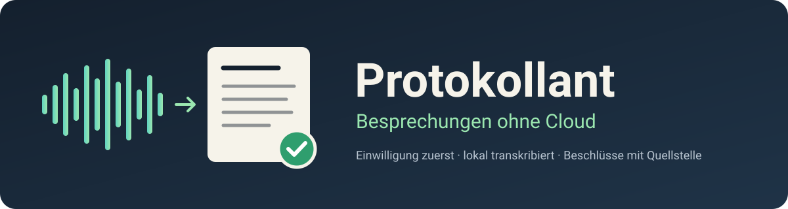
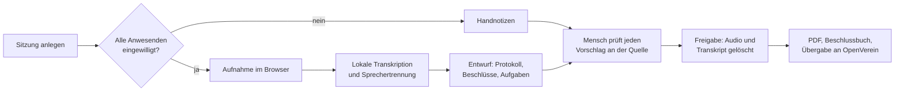

<div align="center">



[](https://github.com/KI-Klub-Werder-e-V/protokollant/actions/workflows/ci.yml)
[](LICENSE)
[](pyproject.toml)
[](#stand)

[Was es tut](#was-protokollant-tut) · [Einwilligung](#einwilligung-zuerst) · [Stand](#stand) · [Häufige Fragen](#häufige-fragen) · [Mitmachen](#mitmachen) · [English](#in-english)

</div>

**Protokollant ist eine selbst gehostete Web-App, die aus der Tonaufnahme einer Vereinssitzung ein Protokoll, ein Beschlussbuch und eine Aufgabenliste macht, ohne dass Audio oder Text den eigenen Rechner verlassen.** Aufgenommen wird nur, wenn alle Anwesenden vorher eingewilligt haben, und jeder Vorschlag der KI muss ein Mensch gegen die Quellstelle prüfen.

Gebaut vom [KI Klub Werder e.V.](https://ki-klub-werder.de) für Vorstandssitzungen und Mitgliederversammlungen, nutzbar für jeden Verein, jedes Gremium und jeden kleinen Betrieb. Lizenz: [AGPL-3.0](LICENSE).

> [!IMPORTANT]
> **Frühe Entwicklung.** Fertig und getestet ist bisher der Kern: der Ablauf mit Einwilligungs-Sperre, Widerruf und Löschung. Weboberfläche, Transkription, Protokollentwurf und Übergabe an OpenVerein entstehen gerade. Den genauen Stand zeigt die Tabelle unter [Stand](#stand).

## Was Protokollant tut



- **Deutsche Transkription** mit [faster-whisper](https://github.com/SYSTRAN/faster-whisper), komplett auf dem eigenen Rechner.
- **Sprechertrennung** mit [pyannote Community-1](https://huggingface.co/pyannote/speaker-diarization-community-1) als Prüfhilfe, ohne gespeicherte Stimmprofile.
- **Protokollentwurf** durch ein lokales Sprachmodell über [Ollama](https://ollama.com) oder jede OpenAI-kompatible Schnittstelle.
- **Vorlage für Vereinsprotokolle:** Ergebnisprotokoll mit Beschlussfähigkeit, Abstimmungen und Unterschriftenzeile, anpassbar an die eigene Satzung.
- **Beschlussbuch:** fortlaufend nummeriert, nur fortschreibbar, durchsuchbar, als PDF und CSV.
- **Übergabe an [OpenVerein](https://github.com/KI-Klub-Werder-e-V/openverein):** Anwesenheit, Abstimmungsergebnisse und Aufgaben, immer mit Vorschau.
- **MCP-Schnittstelle** für KI-Agenten. Agenten dürfen lesen und Entwürfe anlegen, aber weder aufnehmen noch freigeben.

## Einwilligung zuerst

Eine Tonaufnahme des nichtöffentlich gesprochenen Wortes ohne Einwilligung kann nach § 201 StGB strafbar sein. Protokollant setzt die Einwilligung deshalb als Sperre im Code um, nicht als Hinweistext:

| Situation | Was Protokollant tut |
|---|---|
| Eine anwesende Person hat noch nicht geantwortet | Die Aufnahme lässt sich nicht starten, auch nicht über die API. |
| Jemand sagt Nein | Die Sitzung läuft ohne Aufnahme weiter, mit Handnotizen. Der Bildschirm zeigt nur Zahlen, keine Namen. |
| Jemand kommt später dazu | Die Aufnahme pausiert sofort, bis die Person eingewilligt hat. |
| Jemand widerruft | Die Aufnahme stoppt. Auf Wunsch wird alles oder alles ab einem Zeitpunkt gelöscht. |
| Personalthema oder geheime Wahl | Der Tagesordnungspunkt wird als „nicht aufnehmen“ markiert und die Aufnahme pausiert beim Aufruf. |
| Aufnahme von einem anderen Gerät | Upload nur mit Teilnehmerliste und der Erklärung, dass alle vorher eingewilligt haben. |
| Protokoll freigegeben | Audio und Transkript werden gelöscht, der Einwilligungsnachweis bleibt beim Protokoll. |

Einwilligungen, Beschlüsse und das Prüfprotokoll lassen sich in der Datenbank nicht ändern oder löschen.

## Stand

| Baustein | Stand |
|---|---|
| Datenbank mit nur fortschreibbaren Nachweisen | ✅ fertig, getestet |
| Ablauf mit Einwilligungs-Sperre, Nachzüglern, Widerruf, Löschung | ✅ fertig, getestet |
| Weboberfläche und Aufnahme im Browser | 🚧 in Arbeit |
| Transkription und Sprechertrennung | 📋 geplant |
| Protokollentwurf mit Quellstellen | 📋 geplant |
| Prüfung, Freigabe, PDF, Beschlussbuch | 📋 geplant |
| Übergabe an OpenVerein | 📋 geplant |
| MCP-Server, Docker Compose, Offline-Test in der CI | 📋 geplant |

Details: [Spezifikation](docs/SPEC.md) und [Bauplan](docs/BUILD.md).

## Lokal entwickeln

Voraussetzungen: Python 3.12 und [uv](https://docs.astral.sh/uv/).

```sh
git clone https://github.com/KI-Klub-Werder-e-V/protokollant.git
cd protokollant
uv run pytest
```

Eine installierbare Anwendung gibt es noch nicht. Sobald es eine gibt, steht die Anleitung hier.

## Datenschutz

- Audio, Transkript und Entwürfe bleiben auf dem eigenen Server. Die Verarbeitung braucht zur Laufzeit kein Internet.
- Keine Telemetrie, keine Stimmprofile, keine Emotions- oder Stimmungsanalyse.
- Standard ist das Ergebnisprotokoll ohne Namen bei Wortbeiträgen.
- Mitgeliefert werden sollen Muster für Einwilligungstext, Verarbeitungsverzeichnis und Löschkonzept.

Protokollant hilft beim datensparsamen Arbeiten, ersetzt aber keine Prüfung durch Eure Datenschutzbeauftragten. Die Rechtsaussagen in diesem Projekt sind nicht anwaltlich geprüft.

## Häufige Fragen

**Kann ich eine Sitzung aufnehmen, ohne dass alle zustimmen?**
Nein. Solange eine anwesende Person nicht mit Ja erfasst ist, lehnt der Server den Start der Aufnahme ab, in der Oberfläche wie in der API.

**Läuft Protokollant ohne Cloud und ohne Internet?**
Ja, das ist das Ziel. Transkription, Sprechertrennung und Sprachmodell laufen lokal. Internet braucht nur die einmalige Installation der Modelle und auf Wunsch die Übergabe an Eure OpenVerein-Instanz.

**Was passiert mit der Aufnahme?**
Sie wird gelöscht, sobald das Protokoll freigegeben ist, spätestens nach einer festen Frist. Übrig bleiben das Protokoll, die Beschlüsse und der Nachweis, wer wann eingewilligt hat.

**Schreibt die KI das Protokoll allein?**
Nein. Sie schlägt vor, und jeder Beschluss und jede Stimmenzahl muss einzeln bestätigt werden. Vorschläge ohne Quellstelle im Transkript werden verworfen, und fehlende Stimmenzahlen bleiben leer statt geschätzt.

**Erkennt Protokollant, wer spricht?**
Es trennt Stimmen innerhalb einer Sitzung („Sprecher 1, 2“). Namen vergibt ein Mensch. Stimmprofile werden nicht gespeichert und nicht sitzungsübergreifend verglichen.

**Brauche ich OpenVerein?**
Nein. Protokollant funktioniert allein. Mit [OpenVerein](https://github.com/KI-Klub-Werder-e-V/openverein) landen Anwesenheit, Ergebnisse und Aufgaben direkt in der Vereinsverwaltung.

**Welche Hardware brauche ich?**
Ziel ist ein kleiner Rechner ohne Grafikkarte, auf dem eine zweistündige Sitzung über Nacht verarbeitet wird. Gemessen ist das noch nicht, eine Mindestausstattung folgt nach dem Benchmark.

**Wie genau ist die Transkription?**
Noch nicht gemessen. Wir veröffentlichen Wortfehlerrate und Trefferquote bei Beschlüssen erst, wenn ein Testsatz aus echten, nachgestellten Vereinssitzungen vorliegt.

## Weitere Projekte des KI Klub Werder

| Projekt | Worum es geht |
|---|---|
| [OpenVerein](https://github.com/KI-Klub-Werder-e-V/openverein) | Vereinsverwaltung: Mitglieder, Beiträge, SEPA, Buchhaltung, Versammlungen |
| [KI-Box](https://github.com/KI-Klub-Werder-e-V/ki-box) | Lokale KI für einen PC ohne Grafikkarte |
| [Förderradar](https://github.com/KI-Klub-Werder-e-V/foerderradar) | Passende Förderprogramme für Vereine finden |
| [Kommentarwache](https://github.com/KI-Klub-Werder-e-V/kommentarwache) | Selbst gehostete Kommentar-Moderation |

## Mitmachen

Beiträge sind willkommen: Code, Tests, Vorlagen für andere Satzungen, Erfahrungen aus Euren Sitzungen. Lies vorher [CONTRIBUTING.md](CONTRIBUTING.md). Sicherheitslücken bitte vertraulich melden, wie in [SECURITY.md](SECURITY.md) beschrieben.

## In English

**Protokollant** ("minute taker") is a self-hosted web app that turns a recording of a club or board meeting into minutes, a resolution register and a task list, entirely on your own hardware. Recording cannot start until every person present has consented, and every AI suggestion must be checked by a human against its source in the transcript. It transcribes German with faster-whisper, separates speakers with pyannote without storing voiceprints, drafts with a local LLM via Ollama, and hands results to [OpenVerein](https://github.com/KI-Klub-Werder-e-V/openverein). Early development: the consent and deletion core is built and tested. AGPL-3.0.
