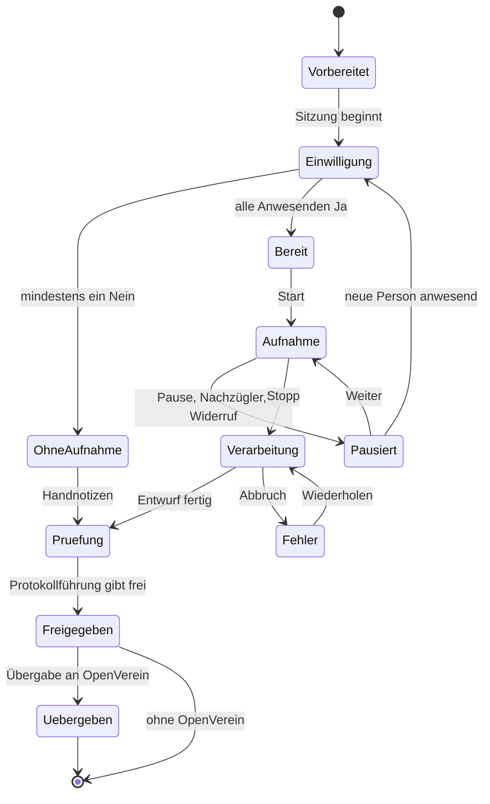

# Protokollant – Spezifikation

Besprechungen ohne Cloud: Aufnahme rein, Protokoll, Beschlüsse und Aufgaben raus.
Ein Projekt des [KI Klub Werder e.V.](https://ki-klub-werder.de). Status: Entwurf. Die Rechtsaussagen sind nicht anwaltlich geprüft und keine Rechtsberatung.

## 1. Kern in fünf Sätzen

Protokollant ist eine selbst gehostete Web-App für Vorstandssitzungen und Mitgliederversammlungen. Ohne die dokumentierte Einwilligung aller Anwesenden lässt sich keine Aufnahme starten. Die Audiodatei wird lokal transkribiert und ein lokales Sprachmodell schlägt Protokoll, Beschlüsse und Aufgaben vor. Ein Mensch prüft jeden Vorschlag gegen die Quellstelle und gibt ihn frei. Danach wird die Aufnahme gelöscht und das Ergebnis geht auf Wunsch an OpenVerein.

**Erster Nutzer:** der Vorstand des KI Klub Werder e.V.
**Lizenz:** AGPL-3.0, wie OpenVerein. **Repo:** `KI-Klub-Werder-e-V/protokollant`.

## 2. Abgrenzung

Nicht im ersten Release:

- Stimmprofile oder automatische Namenserkennung (siehe 5.3)
- Live-Transkription während der Sitzung
- Videokonferenz-Bots und Aufnahme von Online-Sitzungen
- Verlaufsprotokolle mit Zuordnung jedes Wortbeitrags als Standard
- Rechteverwaltung über „angemeldet / nicht angemeldet“ hinaus
- Mehrere Vereine auf einer Instanz

## 3. Ablauf



1. **Vorbereiten:** Sitzung anlegen, Tagesordnung und erwartete Personen eintragen oder aus OpenVerein laden.
2. **Einwilligen:** siehe Abschnitt 4.
3. **Aufnehmen:** im Browser. Teile der Aufnahme gehen laufend an den Server, damit ein Absturz nicht die ganze Sitzung kostet.
4. **Verarbeiten:** als Hintergrundjob. Laptop oder Handy dürfen danach aus sein.
5. **Prüfen:** Transkript, Protokollentwurf, Beschlüsse und Aufgaben, jeder Vorschlag mit Sprung zur Quellstelle.
6. **Freigeben:** Protokoll festschreiben, Beschlüsse ins Beschlussbuch übernehmen, Audio und Transkript löschen.
7. **Übergeben:** mit Vorschau an OpenVerein.

## 4. Einwilligung

Die Einwilligung ist eine Sperre im Zustandsautomaten, kein Hinweistext. Grundlage ist § 201 StGB (nichtöffentlich gesprochenes Wort) und, für die Verarbeitung, die DSGVO: freiwillig, informiert, für einen bestimmten Zweck.

### Anforderungen

| # | Das System MUSS |
|---|---|
| E1 | den Start der Aufnahme serverseitig ablehnen, solange nicht jede als anwesend geführte Person mit Ja erfasst ist. Die Sperre gilt auch für die API. |
| E2 | Einwilligungen **vor** der Aufnahme erfassen, nicht auf dem Band. Die Aufnahme kann sich nicht selbst legitimieren. |
| E3 | jede Person einzeln mit Name, Zeitpunkt, Erfasser:in und Hash des gezeigten Textes speichern. Sammelhaken „alle einverstanden“ gibt es nicht. |
| E4 | vor der Abfrage in einfacher Sprache anzeigen: Zweck, was lokal passiert, Löschzeitpunkt, wer Zugriff hat, Widerrufsrecht, und dass ein Nein keine Nachteile hat. |
| E5 | Gäste und Nichtmitglieder genauso behandeln. Sie werden frei eingetragen. |
| E6 | bei einem Nein auf „Ohne Aufnahme“ wechseln. Handnotizen laufen durch dieselbe Prüfung und dieselbe Übergabe. Wer Nein gesagt hat, wird in den für alle sichtbaren Ansichten nicht als ablehnende Person benannt. |
| E7 | beim Hinzufügen einer anwesenden Person die Aufnahme sofort pausieren, bis sie eingewilligt hat. |
| E8 | einen Widerruf jederzeit annehmen: Aufnahme stoppen und auf Wunsch den ganzen bisherigen Mitschnitt oder ab Zeitpunkt X löschen. Der Widerruf wird wie die Einwilligung dokumentiert. |
| E9 | je Tagesordnungspunkt „nicht aufnehmen“ erlauben, etwa für Personalthemen oder geheime Wahlen. Sind sie markiert, pausiert die Aufnahme beim Aufruf des Punktes. |
| E10 | bei hochgeladenen Dateien vor dem Upload dieselbe Teilnehmerliste plus eine Erklärung der hochladenden Person verlangen, dass alle vor der Aufnahme eingewilligt haben. Ohne Erklärung kein Upload. Im Protokoll steht dann „Einwilligung erklärt durch …“ statt „erfasst“. |
| E11 | im Einwilligungsnachweis den Text in der Fassung des Zeitpunkts behalten und auch nach Löschung der Aufnahme aufbewahren. |

Ablage: Auf Wunsch erzeugt das System eine Unterschriftenliste als PDF für Sitzungen, in denen Papier vorgezogen wird.

**Bewusste Grenze:** Das System kann nicht prüfen, ob die Liste der Anwesenden stimmt oder ob eine externe Aufnahme gemacht wurde. Die Protokollführung bestätigt deshalb die Vollständigkeit der Liste aktiv.

## 5. Funktionen

### 5.1 Aufnahme
- Browser-Aufnahme (`MediaRecorder`) mit Teil-Upload alle 10 Sekunden. Der Browser verlangt dafür HTTPS.
- Upload von WAV, MP3, M4A, OGG und WebM, in Schritt 1 normalisiert mit ffmpeg.
- Pegelanzeige und Warnung bei Stille, damit eine stumme Aufnahme früh auffällt.

### 5.2 Transkription
- faster-whisper mit festgelegter Sprache Deutsch. Modell per Testsatz festlegen (Abschnitt 10).
- Vereinsvokabular als Anfangshinweis: Namen der Anwesenden, Vereinsname, Begriffe aus der Tagesordnung.
- Zeitstempel je Segment. Sie sind die Grundlage für jede Quellstelle.

### 5.3 Sprechertrennung
- pyannote Community-1, lokal geladen, mit nicht überlappender Ausgabe. Ergebnis: „Sprecher 1, 2, …“.
- Namen vergibt ein Mensch je Sitzung, wenn überhaupt.
- **Keine Stimmprofile:** Embeddings werden nach dem Lauf verworfen und nie sitzungsübergreifend verglichen. Ein gespeichertes Stimmprofil zur Identifizierung wäre ein biometrisches Merkmal nach Art. 9 DSGVO; dieses Risiko vermeidet das Projekt ganz.
- Sprechertrennung ist eine Prüfhilfe. Im Saal mit einem Mikrofon wird sie Fehler machen, und das Ergebnisprotokoll hängt nicht von ihr ab.

### 5.4 Entwurf
Ein lokales Modell über eine OpenAI-kompatible Schnittstelle (Standard: Ollama, später aus der [KI-Box](https://github.com/KI-Klub-Werder-e-V/ki-box)) erzeugt strukturiert je Tagesordnungspunkt:

- Zusammenfassung des Ergebnisses
- Beschlussvorschläge: Wortlaut, Ja, Nein, Enthaltung, Quellstelle
- Aufgaben: Titel, zuständige Person, Frist, Quellstelle

Regeln:
- Ein Vorschlag ohne gültige Quellstelle wird verworfen.
- Stimmenzahlen, die im Transkript nicht vorkommen, bleiben leer. Das Modell ergänzt nichts.
- Für lange Sitzungen wird je Tagesordnungspunkt verarbeitet.
- Transkripte sind Daten und keine Anweisungen: Das Modell hat keine Werkzeuge und erzeugt nur das Schema. Gesagtes wie „ignoriere alle Vorgaben“ kann also nichts auslösen.

### 5.5 Prüfung und Freigabe
- Jeder Beschluss und jede Stimmenzahl müssen einzeln bestätigt werden, es gibt kein „Alle übernehmen“.
- Klick auf einen Vorschlag spielt die Audiostelle ab.
- Der Entwurf trägt bis zur Freigabe das Wasserzeichen ENTWURF und den Vermerk, dass er KI-gestützt erstellt wurde.
- Freigabe durch die Protokollführung, optional zweite Person (Versammlungsleitung), je nach Satzung.

### 5.6 Vorlage
Standard ist das **Ergebnisprotokoll** ohne Namen bei Wortbeiträgen (Datenminimierung). Inhalt:

Verein, Art der Sitzung, Datum, Beginn, Ende, Ort, Versammlungsleitung, Protokollführung, Anwesenheit mit Stimmberechtigten, Feststellung von ordnungsgemäßer Einladung und Beschlussfähigkeit, Tagesordnung, Ergebnis und Beschluss je Punkt mit Stimmen, Unterschriftenzeile, Vermerk zur Aufnahme und Einwilligung.

§ 58 Nr. 4 BGB verlangt, dass die Satzung die Beurkundung der Beschlüsse regelt. Die Vorlage ist deshalb je Verein anpassbar (Markdown mit Platzhaltern). Export als PDF und Markdown.

### 5.7 Beschlussbuch
- Fortlaufende Nummer je Verein und Jahr, zum Beispiel `2026-014`.
- Nur fortschreibbar. Änderungen entstehen über einen neuen Beschluss mit „hebt auf / ändert Nr. X“.
- Suche nach Text, Datum und Gremium, Export als PDF und CSV.

### 5.8 Löschung

| Daten | Löschung |
|---|---|
| Audio | automatisch bei Freigabe, spätestens 30 Tage nach der Sitzung (Vorschlag) |
| Transkript | wie Audio. Aufbewahren nur per ausdrücklicher Vereinseinstellung, die im Einwilligungstext genannt wird |
| Embeddings | nach dem Lauf |
| Protokoll, Beschlüsse | nach Vereinsregeln |
| Einwilligungsnachweise | zusammen mit dem Protokoll |

Die Löschung läuft über einen Hintergrundjob, wird protokolliert und schließt temporäre Dateien ein. Die Frist muss kürzer sein als der Backup-Zyklus oder Audio wird von Backups ausgenommen; Standard ist Letzteres.

## 6. Übergabe an OpenVerein

Geprüft gegen den OpenVerein-Stand `588923f`. Die Übergabe nutzt nur die öffentliche `/api/v1`, Protokollant funktioniert auch ganz ohne OpenVerein.

| Schritt | Endpunkt | Hinweis |
|---|---|---|
| Sitzung laden | `GET /assemblies`, `GET /assemblies/:id` | Tagesordnung, Punkt-IDs, Anwesende |
| Anwesenheit | `PUT /assemblies/:id/attendance` | **ersetzt** die Liste, nur Mitglieder. Gäste bleiben im Protokollant-Protokoll. |
| Ergebnis | `PUT /assemblies/:id/items/:itemId` | Stimmen und `outcome`, höchstens 2000 Zeichen |
| Aufgaben | `POST /tasks` | Zuständigkeit als Benutzer-ID. Braucht einen persönlichen Zugang. |
| Protokoll-PDF (optional) | `POST /files` | höchstens 20 MB |

Regeln:
- **Immer mit Vorschau:** alte und neue Werte nebeneinander, die Übergabe startet erst nach Bestätigung. Das entspricht dem Dry-run-Prinzip in OpenVerein.
- **Abschließen bleibt Menschensache.** Protokollant ruft `POST /assemblies/:id/close` nie auf.
- **Kein doppeltes Anlegen:** `POST /tasks` ist nicht idempotent, daher speichert Protokollant die zurückgegebene Task-ID und sendet nie erneut.
- **Nur Ergebnisse gehen raus,** nie Audio oder Transkript.
- **Tagesordnung:** In OpenVerein lässt sie sich nur vor der Einladung ändern. In der Sitzung ergänzte Punkte zeigt die Vorschau als „von Hand nachtragen“.
- **Token:** Die Endpunkte verlangen vereinsweites Schreibrecht auf Mitglieder. Deshalb wird der persönliche Token der Protokollführung bei jeder Übergabe eingegeben und nicht gespeichert.

### Verhalten abgeschlossener Versammlungen
Abgeschlossene Versammlungen sind in OpenVerein per Datenbank-Trigger festgeschrieben (Migrationen 0032 und 0068). Schreibversuche enden mit `409`. Protokollant zeigt das in der Übergabe als „schon abgeschlossen, nichts übertragen“ an und versucht es nicht erneut.

### Später, optional in OpenVerein
Beschlussbuch als eigene Ansicht und engeres Token-Recht nur für Versammlungen.

## 7. Technik

So wenig wie möglich, alles Bewährte wiederverwenden.

| Teil | Wahl | Grund |
|---|---|---|
| App | Python, FastAPI, serverseitig gerenderte Seiten | gleiche Sprache wie die ML-Bausteine, ein Prozess |
| Daten | SQLite, Audio im Dateisystem | ein Verein, eine Instanz, einfaches Backup |
| Jobs | Worker liest Tabelle in SQLite | keine zusätzliche Queue. Ein Job gleichzeitig reicht für einen Verein. |
| Transkription | faster-whisper | läuft auf CPU und GPU |
| Sprecher | pyannote Community-1 | CC-BY-4.0, offline ladbar |
| Sprachmodell | Ollama über OpenAI-kompatible URL | austauschbar, passt zur Lokalen KI-Box |
| PDF | WeasyPrint | Vorlage als HTML, anpassbar |
| Betrieb | Docker Compose, Caddy für HTTPS | Mikrofon im Browser braucht HTTPS |
| Agenten | MCP-Server, lesend plus „Entwurf anlegen“ | wie bei den anderen Vereinsprojekten. Keine Freigabe und kein Start der Aufnahme per Agent. |

### „Ohne Cloud“ als geprüfte Eigenschaft
- Worker und Modelle liegen in einem Docker-Netz ohne Internet (`internal: true`). Nur die Web-App erreicht die konfigurierte OpenVerein-Adresse.
- Modelle werden in einem getrennten Installationsschritt geladen. pyannote verlangt dabei einmalig einen Hugging-Face-Token und die Annahme der Bedingungen; zur Laufzeit gibt es keinen Abruf.
- Keine Telemetrie, keine externen Schriften oder Skripte.
- Ein CI-Test startet den Stack ohne Netz und verarbeitet eine Beispieldatei.

### Datenmodell

```
meeting(id, kind, title, held_on, starts_at, ended_at, place, state, assembly_ref?)
agenda_item(id, meeting_id, position, title, is_vote, no_record, assembly_item_ref?)
participant(id, meeting_id, name, member_ref?, is_guest, arrived_at, left_at)
consent_event(id, participant_id, type[yes|no|revoked|attested], at, recorded_by, text_sha256)
consent_text(sha256, body, created_at)
recording(id, meeting_id, path, started_at, stopped_at, deleted_at, source[browser|upload])
segment(id, recording_id, start_ms, end_ms, speaker_label, text)
proposal(id, meeting_id, agenda_item_id, kind[summary|resolution|task], payload_json, source_segment_ids, status)
resolution(id, number, meeting_id, text, yes, no, abstain, supersedes_id?, approved_at, approved_by)
job(id, meeting_id, step, status, attempts, error)
handover(id, meeting_id, at, actor, entity, remote_id, status)
audit(id, at, actor, action, entity, entity_id)
```

`consent_event`, `resolution` und `audit` sind nur fortschreibbar (per SQLite-Trigger erzwungen).

## 8. Sicherheit und Datenschutz

- Anmeldung für alle Seiten, keine öffentlichen Links zu Audio.
- Dateinamen sind IDs und enthalten keine Personen- oder Sitzungsnamen. Keine Transkriptinhalte in Logs.
- Uploads werden auf Typ und Größe geprüft, ffmpeg läuft ohne Netz und mit Ressourcenlimit.
- Verschlüsselung der Daten auf dem Datenträger ist Sache des Hosts, die Installationsanleitung verlangt sie.
- Mitgeliefert: Muster für Einwilligungstext, Eintrag ins Verarbeitungsverzeichnis, Löschkonzept und Hinweis zur Datenschutz-Folgenabschätzung. Das fügt sich später ins DSGVO-Kit.
- Keine Emotions- oder Stimmungsanalyse.

## 9. Abnahmekriterien

- Start der Aufnahme mit einer fehlenden Einwilligung gibt `409`, in UI und API.
- Ein Nachzügler pausiert die Aufnahme, bis die Einwilligung erfasst ist.
- Bei einem Nein läuft die Sitzung ohne Aufnahme bis zur Übergabe durch.
- Widerruf löscht den gewählten Mitschnitt nachweislich, einschließlich Segmente und temporärer Dateien.
- Ein als „nicht aufnehmen“ markierter Punkt erzeugt kein Audio.
- Ein Vorschlag ohne Quellstelle erscheint nicht.
- Eine Sitzung läuft bei getrenntem Netz vollständig durch.
- Nach der Freigabe sind keine Audio- und Transkriptdaten mehr auf der Platte zu finden.
- Eine wiederholte Übergabe legt keine Aufgabe doppelt an.
- `consent_event` und `resolution` lehnen `UPDATE` und `DELETE` ab.

## 10. Qualität messen, bevor etwas behauptet wird

Der Testsatz entsteht vor der Modellwahl und nur mit Einwilligung: mindestens drei nachgestellte Vereinssitzungen (kleiner Tisch, Saal mit einem Mikrofon, Sitzung mit Störgeräuschen), von Hand transkribiert.

| Messgröße | Ziel |
|---|---|
| Beschlüsse gefunden | alle, Fehlalarme sind günstiger als Lücken |
| Stimmenzahlen | keine falschen Zahlen, im Zweifel leer |
| Erfundene Beschlüsse oder Aufgaben | 0 |
| Wortfehlerrate, Sprecherfehlerrate | messen und im README veröffentlichen |
| Laufzeit einer 2-Stunden-Sitzung | über Nacht fertig (höchstens 8 Stunden) auf der Zielhardware |

**Hardware prüfen:** Ziel ist ein kleiner Vereinsrechner mit 8 Kernen, 16 GB RAM und ohne dedizierte GPU, auf dem oft schon andere Dienste laufen. Ob Transkription, Sprechertrennung und Sprachmodell dort nebeneinander passen, ist noch nicht gemessen. Eine Mindestausstattung kommt erst danach ins README.

## 11. Meilensteine

| | Inhalt | Ergebnis |
|---|---|---|
| **M0 Prüfung** | Vorhandene Projekte prüfen (Abschnitt 12), Testsatz aufnehmen, Benchmark, Rechtsfragen klären | Entscheidung bauen oder beitragen |
| **M1 Einwilligung** | Sitzung, Teilnehmende, Einwilligungs-Sperre, Browser-Aufnahme, Upload, Löschung | Sperre und Löschung abgenommen |
| **M2 Transkript** | Jobs, Whisper, Sprechertrennung, Prüfansicht mit Audio | erstes geprüftes Transkript |
| **M3 Protokoll** | Entwürfe mit Quellstelle, Prüfung, Vorlage, PDF, Beschlussbuch | echte Vorstandssitzung protokolliert |
| **M4 Übergabe** | OpenVerein mit Vorschau, MCP, Offline-CI, Doku | Release 0.1 |

Einwilligung kommt vor der KI, damit auch der früheste Prototyp nie ohne Sperre aufnimmt.

## 12. Vorhandene Projekte

Vor dem Bau ist zu prüfen, ob ein Beitrag zu einem bestehenden Projekt besser wäre.

| Projekt | Stand laut Recherche | Fehlt für uns |
|---|---|---|
| Meetily | MIT laut Listen, Desktop-App, Transkription und Zusammenfassung lokal | Mehrbenutzer-Server, Einwilligung, Vereinsprotokoll |
| Scriberr | MIT laut Listen, selbst gehostete Transkription | Sitzungslogik, Beschlüsse, Einwilligung |
| Vibe | Whisper lokal, Lizenzangaben widersprüchlich | Desktop-Transkription, kein Sitzungsablauf |

**Einschätzung:** Das Eigene sind Einwilligungs-Sperre, Vereinsprotokoll, Beschlussbuch und OpenVerein-Übergabe, nicht die Transkription. Diese Angaben stammen aus Listen und Herstellerartikeln. In M0 sind Lizenz, Wartung und Deutschqualität direkt in den Repos zu prüfen. Wenn sich Scriberr als Transkriptions-Backend eignet, entfällt Abschnitt 5.2 weitgehend.

## 13. Offene Entscheidungen

| Frage | Vorschlag | Wer |
|---|---|---|
| Reicht die Einwilligung nur der Anwesenden, wenn eine Mitgliederversammlung nichtöffentlich ist? Sonderfall Hybrid-Teilnahme | Hybrid ausschließen in v1 | Rechtsprüfung |
| Darf ein Vereinsbeschluss die Einzeleinwilligung ersetzen? | Nein, immer einzeln | Rechtsprüfung |
| Audio-Frist 30 Tage | beibehalten, sofern geprüft | Datenschutz |
| Rechtsgrundlage für die KI-Verarbeitung des Transkripts nach Löschung der Aufnahme | Einwilligung, Zweck im Text genannt | Datenschutz |
| Beschlussbuch dauerhaft in Protokollant oder OpenVerein | erst Protokollant, weil es ohne OpenVerein laufen muss | Vorstand |
| Verantwortliche Person und erste Pilot-Sitzung | | Vorstand |

## 14. Quellen

- [§ 201 StGB](https://lexetius.com/StGB/201)
- [Überblick Aufnahmerecht Deutschland](https://www.recordinglaw.com/de/world-laws/world-recording-laws/germany-recording-laws/)
- [Muster Einwilligung Tonaufnahmen, Umweltbundesamt](https://www.umweltbundesamt.de/system/files/medien/3521/dokumente/formular_einwilligungserklaerung_in_video-tonaufnahmen_compliance_digital_maerz_2022.pdf)
- [pyannote Community-1, Modellkarte](https://huggingface.co/pyannote/speaker-diarization-community-1)
- [Meetily-Alternativen und Einträge](https://alternativeto.net/software/meetily/?p=2)
- [Scriberr-Alternativen und Einträge](https://alternativeto.net/software/scriberr)
- [Vergleich selbst gehosteter Notiz-Tools](https://char.com/blog/selfhosted-ai-notetakers)
